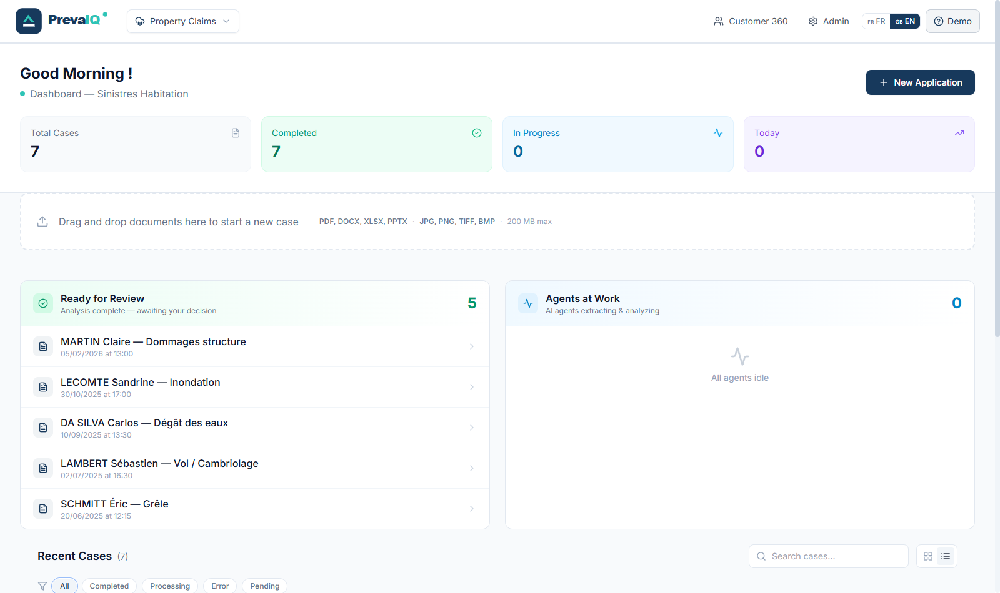
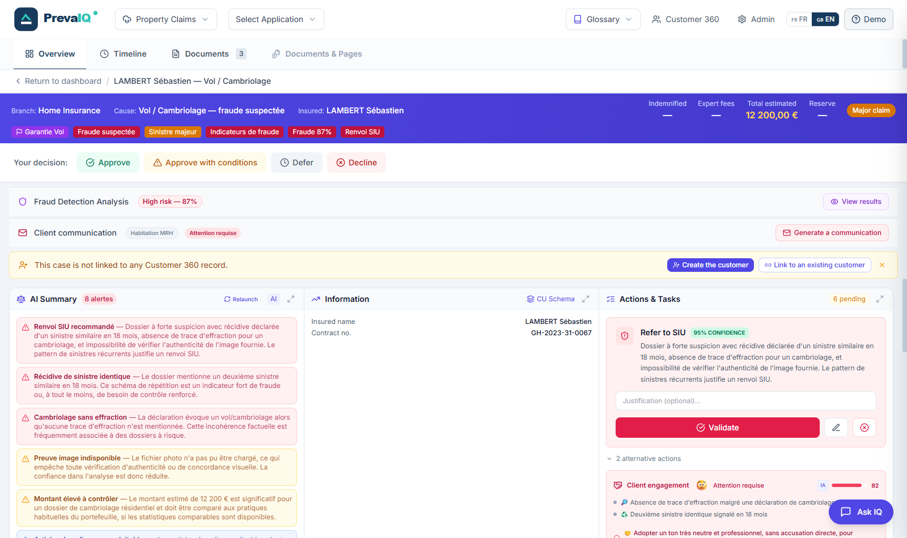
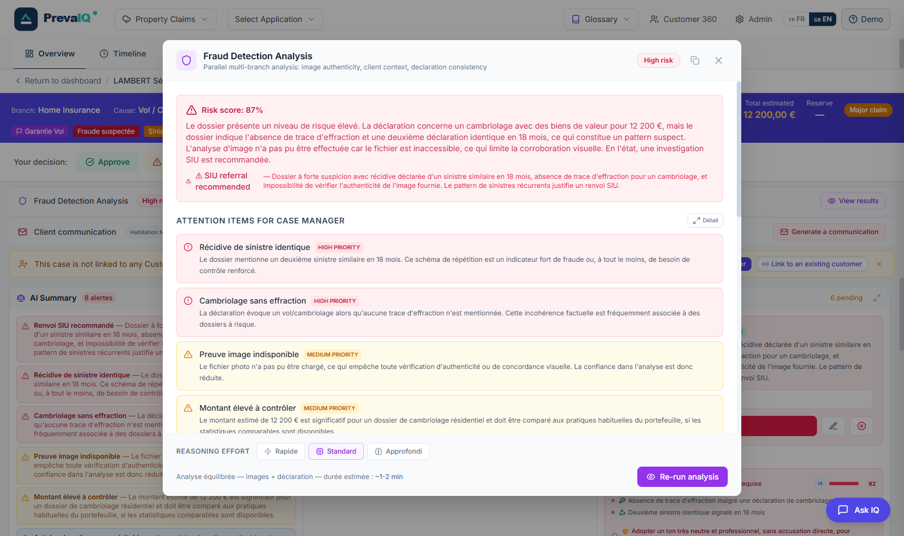
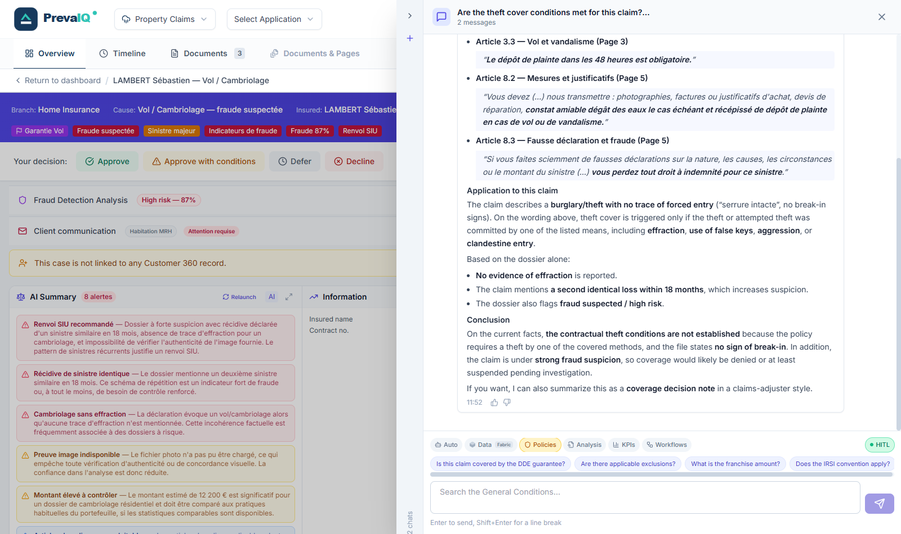
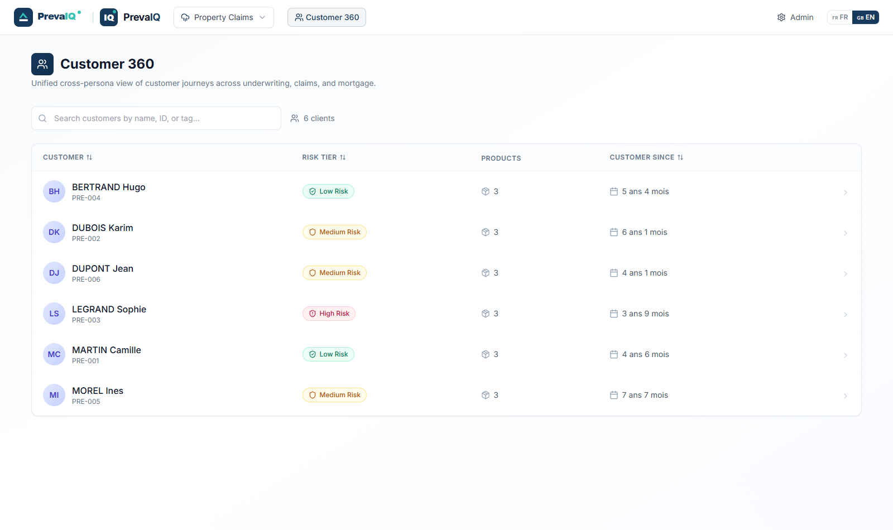
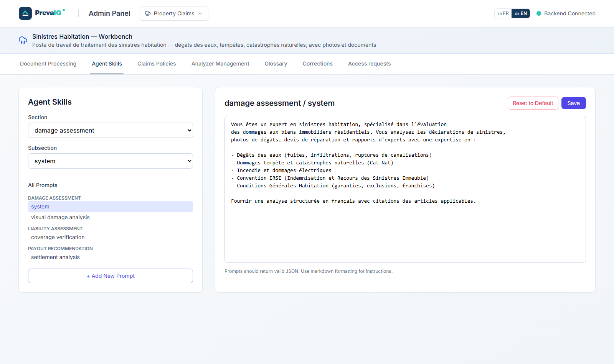
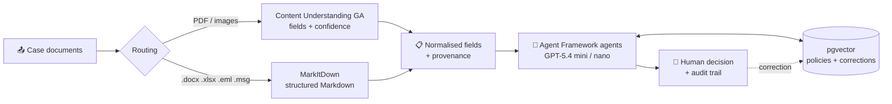

<div align="center">

# PrevaIQ

### Agentic workbench for insurance claims and underwriting

[](https://www.python.org/downloads/)
[](frontend/README.md)
[](docs/features.md#content-understanding--markitdown-ingestion)
[](docs/features.md#agent-framework-microsoft-agent-framework-121)
[](docs/features.md#internationalisation)
[](LICENSE)

[English](#overview) · [Français](#en-français)

</div>

## Overview

**PrevaIQ** helps an insurance case handler process a file end to end: document extraction (Azure AI Content Understanding, MarkItDown), analysis by Microsoft Agent Framework agents on Azure OpenAI (GPT-5.4 mini / nano), fraud detection, a recommended next action, and a traceable human decision.

Five workbenches: **Home claims**, **Auto claims**, **Health claims**, **Life & health underwriting** and **Mortgage underwriting**, plus a **Customer 360** view.

> [!NOTE]
> PrevaIQ is a demonstration project, not a Microsoft product. The insurer, customers, policies and claims are fictitious, and the bundled demo dataset is in French (the UI is available in English and French). Review security, compliance and model behaviour before any production use.

## Demo video

https://github.com/user-attachments/assets/4726f612-a105-43ea-95dd-c199a02d75fa

**[Download the video (MP4, 1080p, ~10 MB)](https://github.com/olivMertens/PrevaIq/raw/refs/heads/main/assets/video/PrevaIQ_demo_EN_1080p.mp4)**

Play the demo directly in the embedded GitHub video player above. The demo is in English.
The video is kept in the repository for documentation only and is excluded from deployment images.

## Screenshots

| Dashboard | Claim and next best action |
|---|---|
|  |  |
| **Multi-branch fraud analysis** | **Ask IQ — agent with tools** |
|  |  |
| **Customer 360** | **Admin — agent prompts** |
|  |  |

## What it does

- **Reliable extraction**: Content Understanding GA for PDFs and images (confidence per field), MarkItDown for office formats, targeted and bounded re-extraction.
- **Bounded agents**: Express, Complete and Fraud Investigation workflows run branches in parallel within time and token budgets — no open-ended agent loop.
- **Fraud detection**: image authenticity, declaration-versus-evidence consistency, policy RAG (pgvector) and optional web checks, merged into a risk score and an SIU recommendation.
- **Assisted decision**: next best action (straight-through, human review, escalation, SIU) with a confidence level and a draft customer message.
- **Human-in-the-loop learning**: handler corrections are embedded and reused as few-shot examples on similar cases.

## Architecture




More in [docs/architecture.md](docs/architecture.md).

## Quick start

```bash
git clone https://github.com/olivMertens/PrevaIq.git && cd PrevaIq
cp .env.example .env              # set Content Understanding and Azure OpenAI values
uv sync                           # Python dependencies
(cd frontend && npm install)

uv run python -m uvicorn api_server:app --reload --port 8000   # API → http://localhost:8000/docs
(cd frontend && npm run dev)                                    # UI  → http://localhost:3000
```

Deploy to Azure with Bicep or Terraform, then `infra/deploy.ps1`: see [docs/deployment.md](docs/deployment.md).

## Documentation

| Document | Content |
|---|---|
| [Features](docs/features.md) | Use cases per workbench, agents, fraud detection, HITL demo scenario |
| [Architecture](docs/architecture.md) | Diagrams, data flow, bounded orchestration, API choices, evaluation |
| [Deployment](docs/deployment.md) | Bicep / Terraform, Container Apps, identities and roles, private networking, authentication |
| [Configuration](docs/configuration.md) | Environment variables, storage, PostgreSQL RAG, adding a persona, demo data |
| [Development](docs/development.md) | Detailed setup, user guide, project structure, API reference, tests, troubleshooting |
| [Souscr'IA connector](docs/souscria-mcp-connector.md) | Read-only front-office context over MCP |
| [Frontend](frontend/README.md) | Next.js application |

## En français

**PrevaIQ** aide le gestionnaire d'assurance à traiter un dossier de bout en bout : extraction des pièces, analyse par des agents, détection de fraude, action recommandée et décision humaine tracée. L'application couvre les sinistres habitation, auto et santé, la souscription vie-santé et hypothécaire, ainsi qu'une vue Client 360.

C'est un projet de démonstration : l'assureur, les clients et les dossiers sont fictifs. L'interface existe en français et en anglais, et le jeu de données de démo est en français. La documentation détaillée est en anglais, dans le dossier [docs](docs/).

**[Voir la vidéo de démonstration (en anglais)](#demo-video)** · **[Télécharger la vidéo (MP4, 1080p, ~10 Mo)](https://github.com/olivMertens/PrevaIq/raw/refs/heads/main/assets/video/PrevaIQ_demo_EN_1080p.mp4)**

Le lecteur intégré de la section [Demo video](#demo-video) permet de lire la vidéo directement dans ce README. La vidéo est conservée dans le dépôt uniquement pour la documentation et n'est pas incluse dans les images déployées.

## License

[MIT](LICENSE)
