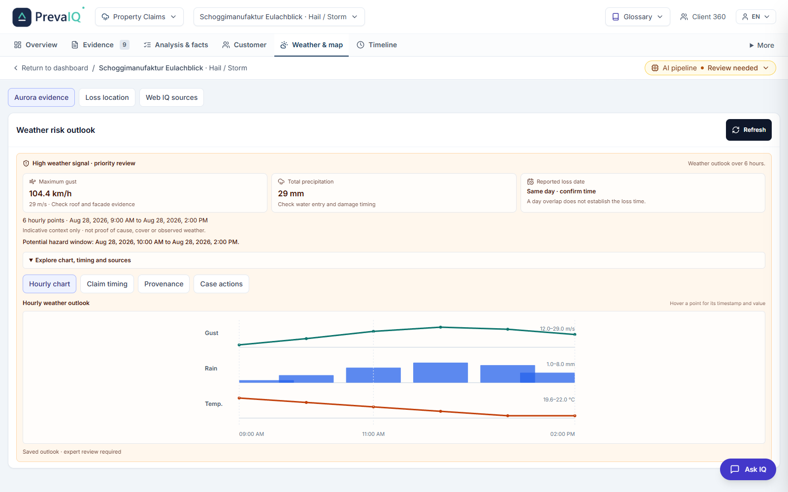
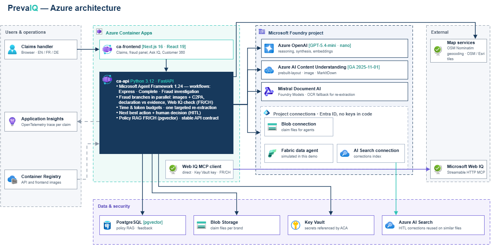
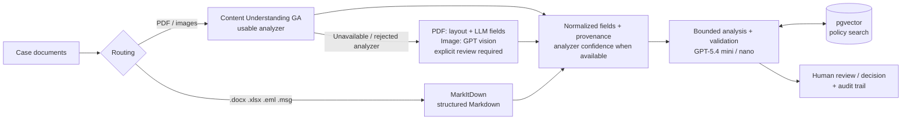

<div align="center">

# PrevaIQ

### Agentic workbench for insurance claims and underwriting

[](https://www.python.org/downloads/)
[](frontend/README.md)
[](docs/features.md#content-understanding--markitdown-ingestion)
[](docs/features.md#agent-framework-microsoft-agent-framework-124)
[](docs/features.md#internationalisation)
[](LICENSE)

[English](#overview) · [Français](#en-français)

</div>

## Overview

**PrevaIQ** helps an insurance case handler process a file end to end: document extraction (Azure AI Content Understanding, MarkItDown), analysis by Microsoft Agent Framework agents on Azure OpenAI (GPT-5.4 mini / nano), fraud detection, a recommended next action, and a traceable human decision.

Five workbenches: **Property claims** (home / business), **Auto claims**, **Health claims**, **Life & health underwriting** and **Mortgage underwriting**, plus a **Customer 360** view.

> [!NOTE]
> PrevaIQ is a demonstration project, not a Microsoft product. The insurer, customers, policies and claims are fictitious. Demo scenarios include French and Swiss documents; the UI supports English, French, German and Swiss German. Source documents keep their original language. Review security, compliance and model behaviour before any production use.

## Demo video

https://github.com/user-attachments/assets/4726f612-a105-43ea-95dd-c199a02d75fa

**[Download the video (MP4, 1080p, ~10 MB)](https://github.com/olivMertens/PrevaIq/raw/refs/heads/main/assets/video/PrevaIQ_demo_EN_1080p.mp4)**

Play the English demo directly in the embedded GitHub video player above. This earlier
recording illustrates the workflow; the screenshots below show the current interface.
The video is kept for documentation only and is excluded from deployment images.

## Screenshots

The captures use the local source frontend with existing fictitious DEMO data,
the English locale and light mode. Some views are cropped to omit account metadata.
They show saved case results, without re-running analysis or forecasts; policy
quotations keep their source language.

| Property claims dashboard | Claim overview and next actions |
|---|---|
|  |  |
| **Multi-branch fraud analysis** | **Ask IQ — agent with tools** |
|  |  |
| **Customer 360** | **Admin — explicit weather simulation** |
|  |  |



The weather capture uses the explicitly authorized synthetic scenario. It is not
observed weather, evidence of the loss, or proof of a successful Azure model call.

## What it does

- **Traceable extraction**: Content Understanding GA when a usable analyzer is available, MarkItDown for office formats, and explicit layout/LLM or GPT vision fallbacks. Provenance distinguishes model-inferred fields from analyzer confidence; fallback output requires review.
- **Bounded orchestration**: time, token and re-extraction budgets; only executable prompt steps run, not persona descriptions or metadata. Express, Complete and Fraud Investigation workflows run independent branches in parallel — no open-ended agent loop.
- **Fraud detection**: image authenticity, declaration-versus-evidence consistency, policy RAG (pgvector) and optional web checks, merged into a risk score and an SIU recommendation.
- **Assisted decision**: next best action (straight-through, human review, escalation, SIU) with a confidence level and a draft customer message.
- **Human-in-the-loop learning**: handler corrections are embedded and reused as few-shot examples on similar cases.
- **Localized case workspace**: Overview, Evidence, Analysis & facts, Customer, Weather & map and Timeline, with technical views under More. Translated analysis is separate from original OCR evidence.
- **Preserved decisions and weather**: full re-analysis replaces analysis outputs without erasing the recorded decision or saved real/synthetic weather evidence.

### Reliability and current limits

- FastAPI request telemetry, agent/stage spans and failure logs feed Application Insights. Azure Monitor alerts cover API HTTP 5xx and failed analysis steps; email notification requires an action-group recipient.
- Blob protection defaults enable versioning, 7-day blob/container soft delete and 30-day previous-version retention. These are recovery controls, not a substitute for a tested backup/restore procedure.
- Unavailable custom analyzers and LLM-inferred fields remain explicit review conditions. Jobs and progress are still process-local, not a durable distributed queue.
- Some localization gaps remain: the Customer 360 tenure formatter still renders French year/month units in the English locale.
- AI recommendations, fraud signals and weather outlooks are advisory. A handler remains accountable for coverage, escalation and the final decision.

## Architecture





The [controlled orchestration view](docs/architecture/prevaiq-orchestration.png)
shows budgets, bounded re-extraction and preserved evidence. See
[Architecture](docs/architecture.md) for editable diagram sources, the real Aurora
task/Blob contract and the separate simulation flow.

## Quick start

```bash
git clone https://github.com/olivMertens/PrevaIq.git && cd PrevaIq
cp .env.example .env              # set Content Understanding and Azure OpenAI values
uv sync                           # Python dependencies
(cd frontend && npm ci)

uv run python -m uvicorn api_server:app --reload --port 8000   # API → http://localhost:8000/docs
(cd frontend && npm run dev)                                    # UI  → http://localhost:3000
```

Deploy to Azure with Bicep or Terraform, then `infra/deploy.ps1`: see [docs/deployment.md](docs/deployment.md).

### Validation

```bash
uv run pytest                     # integration tests require explicit opt-in
(cd frontend && npm test)
(cd frontend && npx tsc --noEmit)
```

CI runs the Python and frontend tests in addition to lint/type/build checks.
Model, API or extraction changes also need a comparison with
[`scripts/eval_pipeline.py`](scripts/eval_pipeline.py); unit tests alone do not
establish model quality.

### Weather outlook: real Aurora versus explicit simulation

Aurora 1.5 is a [Microsoft environmental forecasting model](https://www.microsoft.com/en-us/research/blog/aurora-1-5-extending-open-foundation-models-for-weather-and-earth-system-applications/), not a chat model. It
provides optional advisory context in **Weather & map**. The saved outlook exposes
hourly gust, precipitation and temperature, the hazard window, loss-date alignment,
provenance and suggested review actions. Opening a dossier or Ask IQ reads saved
evidence; it does not launch a new forecast.

**Explicit simulation** is an administrator-authorized, off-by-default mode for
the chocolate workshop, watch manufacture and wine-cellar scenarios. It validates
the local 6/12-hour contract without calling a model or weather Blob channel.
Synthetic results carry explicit API provenance in `llm_outputs.aurora_demo`;
real evidence remains separate in `llm_outputs.aurora`. Simulation is **never an
automatic fallback** from failed inference and does not stop a provisioned GPU's
billing.

**Real inference** uses the [official task/Blob
protocol](https://github.com/microsoft/aurora/blob/main/docs/foundry/notes.md),
not Azure OpenAI chat or the separate Azure ML batch-job API. A managed scoring
endpoint, valid NetCDF initial conditions with two history steps, and a private
task channel are required. The app uses managed identity for Blob access and
creates short-lived delegated SAS access for the model. Endpoint authentication
comes from deployment secrets, never browser/admin configuration.

In **Admin > Aurora**, save non-secret configuration and run the real Azure
readiness checks separately from simulation validation. Reads do not acquire a
configuration write lease; configuration updates use a bounded lease. An application
health check, a saved historical forecast or a simulation result does not prove
current model availability. Historical ERA5-based results are not present-day
weather observations.

Benchmark real outputs against an accepted meteorological baseline for the
geography and variables used. No mode may autonomously deny, price, approve or pay
a claim. See [Architecture](docs/architecture.md#explicit-aurora-demo-simulation)
and [Deployment](docs/deployment.md) for mode boundaries and operational setup.

The repository-local
[Aurora skill](.github/skills/msresearch-aurora/SKILL.md) contains the managed
endpoint workflow, input contract, evaluation gate, troubleshooting path, and
upstream Microsoft Research Vibe Kit attribution without vendoring its large
research and sample-data assets.

## Documentation

| Document | Content |
|---|---|
| [Features](docs/features.md) | Use cases per workbench, agents, fraud detection, HITL demo scenario |
| [Architecture](docs/architecture.md) | Diagrams, data flow, bounded orchestration, API choices, evaluation |
| [Deployment](docs/deployment.md) | Bicep / Terraform, Container Apps, identities and roles, private networking, authentication |
| [Configuration](docs/configuration.md) | Environment variables, storage, PostgreSQL RAG, adding a persona, demo data |
| [Development](docs/development.md) | Detailed setup, user guide, project structure, API reference, tests, troubleshooting |
| [Souscr'IA connector](docs/souscria-mcp-connector.md) | Read-only front-office context over MCP |
| [Frontend](frontend/README.md) | Next.js application |

## En français

**PrevaIQ** aide le gestionnaire d'assurance à traiter un dossier de bout en bout : extraction des pièces, analyse par des agents, détection de fraude, action recommandée et décision humaine tracée. L'application couvre les sinistres habitation/entreprise, auto et santé, la souscription vie-santé et hypothécaire, ainsi qu'une vue Client 360.

C'est un projet de démonstration : l'assureur, les clients et les dossiers sont fictifs. L'interface existe en anglais, français, allemand et allemand suisse ; les scénarios incluent des documents français et suisses, conservés dans leur langue d'origine. Les analyses traduites restent distinctes des pièces sources.

Les captures montrent l'interface actuelle et des résultats enregistrés. La météo illustrée est une **simulation explicitement autorisée**, pas une observation ni une inférence Azure attestée. Les budgets bornent les traitements ; la réanalyse conserve les décisions et les résultats météo. Les champs déduits par LLM et les erreurs imposent une revue. La télémétrie, les alertes et la protection Blob améliorent l'exploitation, mais les tâches ne disposent pas encore d'une file distribuée durable. Un reliquat de traduction subsiste pour l'ancienneté Client 360. La décision finale reste humaine.

La documentation détaillée est en anglais, dans le dossier [docs](docs/).

**[Voir la vidéo de démonstration (en anglais)](#demo-video)** · **[Télécharger la vidéo (MP4, 1080p, ~10 Mo)](https://github.com/olivMertens/PrevaIq/raw/refs/heads/main/assets/video/PrevaIQ_demo_EN_1080p.mp4)**

Le lecteur intégré de la section [Demo video](#demo-video) présente un enregistrement antérieur du parcours ; les captures ci-dessus font référence pour l'interface actuelle. La vidéo est conservée uniquement pour la documentation et n'est pas incluse dans les images déployées.

## License

[MIT](LICENSE)
