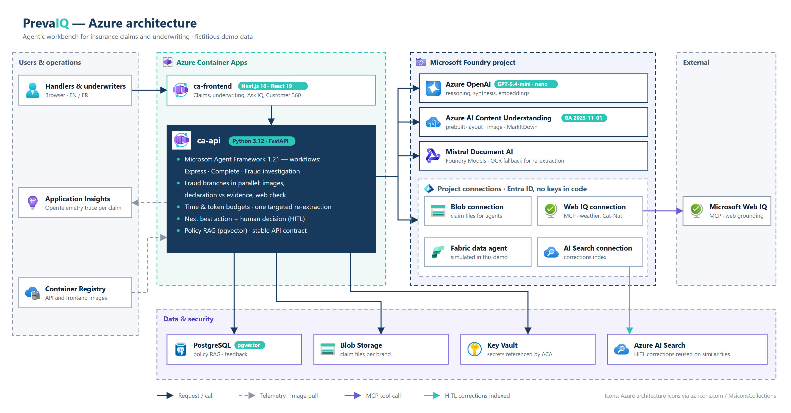
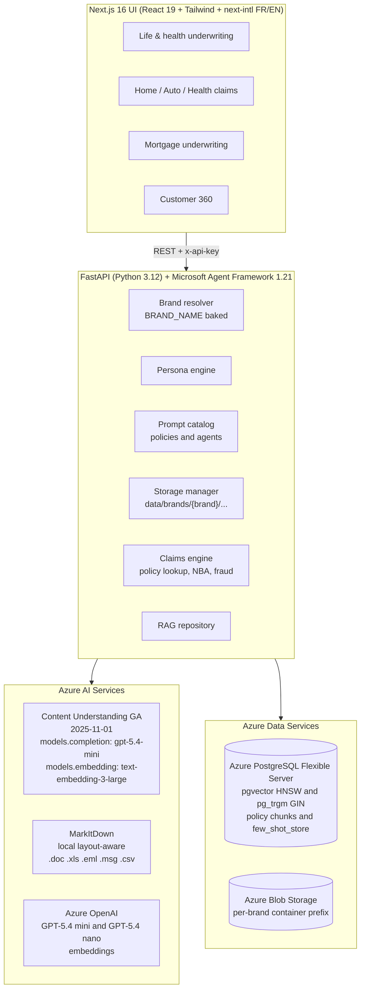
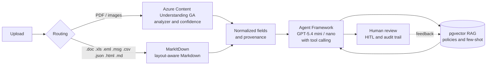
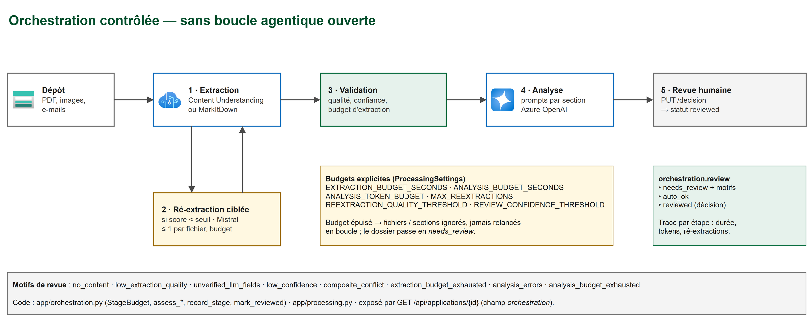
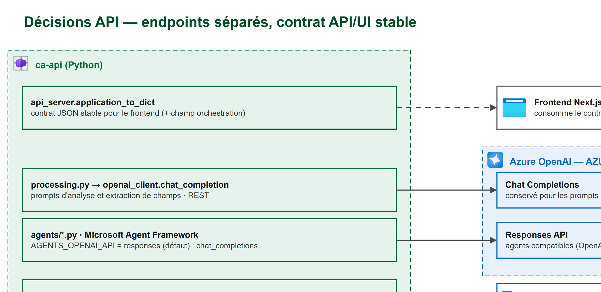

# Architecture



Editable sources and exports are in [docs/architecture/](architecture/) (`.drawio` is the source of truth, with standalone `.svg` and `.png` exports). The overview shows the Microsoft Foundry project with its Entra ID connections (Blob, Web IQ over MCP, Fabric data agent — simulated in the demo — and Azure AI Search, where human corrections are indexed and reused on similar files). Azure icons come from [az-icons.com](https://az-icons.com/) (Azure Architecture Icons pack) and, where it has no match, from [MsiconsCollections](https://aka.ms/MsiconsCollections) (Container Apps, Microsoft Fabric, Microsoft Entra ID); they are Microsoft property under the [icon terms](https://learn.microsoft.com/en-us/azure/architecture/icons/#icon-terms). Services without a dedicated icon use the closest real one with an explicit label: *AI Services* for Content Understanding, *Foundry Models* for Mistral Document AI and the generic *Globe* for Microsoft Web IQ. Diagrams are maintained with [`.github/skills/architecture-diagram-author`](../.github/skills/architecture-diagram-author/SKILL.md).



## Data flow



## Controlled orchestration



The pipeline is extraction -> targeted bounded re-extraction -> validation -> analysis -> human review, with no open-ended agent loop (`app/orchestration.py`).

- **Explicit budgets** per stage (`StageBudget`): wall-clock time through `EXTRACTION_BUDGET_SECONDS` and `ANALYSIS_BUDGET_SECONDS`, analysis tokens through `ANALYSIS_TOKEN_BUDGET`, and re-extractions through `MAX_REEXTRACTIONS`. Exhausted budgets skip remaining files or sections instead of restarting loops.
- **Targeted re-extraction** applies only to documents whose quality score is below `REEXTRACTION_QUALITY_THRESHOLD`, at most once per file, using Mistral Document AI. The best result is kept.
- **Validation** produces review reasons for extraction quality, average confidence below `REVIEW_CONFIDENCE_THRESHOLD`, LLM-extracted fields, composite documents, analysis errors, and exhausted budgets.
- **Human review** uses `orchestration.review.status`: `needs_review`, `auto_ok`, or `reviewed` after `PUT /api/applications/{id}/decision`. The stage trace exposes duration, tokens, re-extractions, and skipped items in `GET /api/applications/{id}` and in the AI pipeline banner.

## API decisions



| Usage | API | Endpoint |
|-------|-----|----------|
| JSON analysis prompts and field extraction (`app/openai_client.py`) | Chat Completions, retained | `AZURE_OPENAI_ENDPOINT` |
| Microsoft Agent Framework agents for chat and workflows | Responses through `OpenAIChatClient`, with rollback `AGENTS_OPENAI_API=chat_completions` | `AZURE_OPENAI_ENDPOINT` |
| Foundry agents for Web Intelligence and Fabric Data Agent | Responses `agent_reference` through `AIProjectClient` | `FOUNDRY_PROJECT_ENDPOINT` (`settings.foundry`) |
| Document extraction | Content Understanding GA `2025-11-01` | `AZURE_CONTENT_UNDERSTANDING_ENDPOINT` |

The API/UI contract stays stable during migration: `application_to_dict` keys are pinned by `tests/test_orchestration.py::test_application_contract_keys_are_stable`. Additions are allowed; removals are not.

## Evaluation before rollout

`scripts/eval_pipeline.py` runs the reference set in `tests/fixtures/eval/manifest.json` for each variant and compares it to the first variant, which is the baseline.

| Metric | Definition |
|--------|------------|
| `quality` | Share of expected values present in extracted Markdown |
| `completeness` | Share of expected values captured as structured fields |
| `citations` | Share of expected references present in the analysis or workflow |
| `extraction_s`, `analysis_s`, `workflow_s` | Latency by stage |
| `tokens`, `cost` | Analysis tokens and cost, using `tests/fixtures/eval/prices.json` after prices are filled in |

```bash
python scripts/eval_pipeline.py \
  --variant baseline \
  --variant chat_completions:AGENTS_OPENAI_API=chat_completions \
  --workflow express
```

Reports are written to `.tmp/eval/<timestamp>/` as `results.json` and `summary.md`. A variant rolls out only if quality, completeness, and citations are at least baseline, and latency, tokens, and cost stay within the agreed tolerance. The script calls real Azure services and can incur cost.

