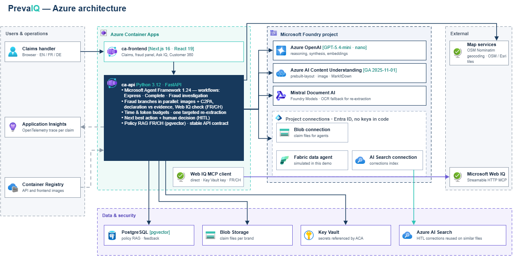
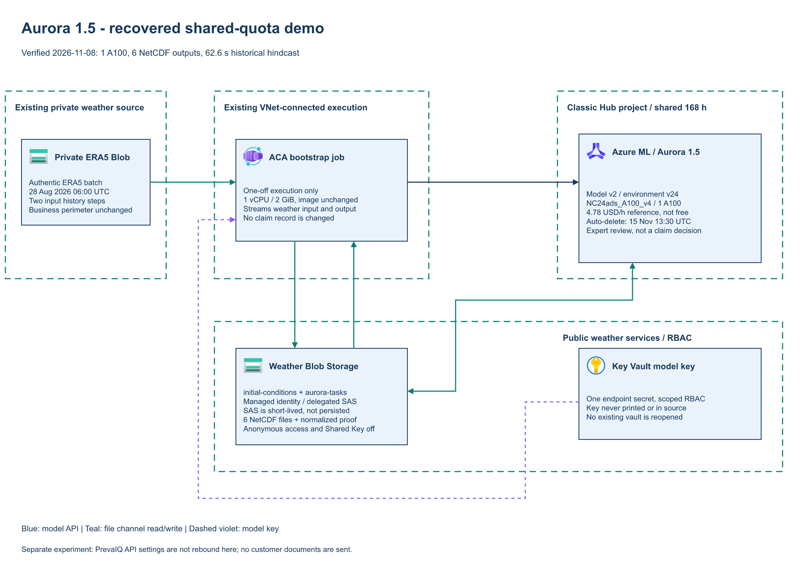
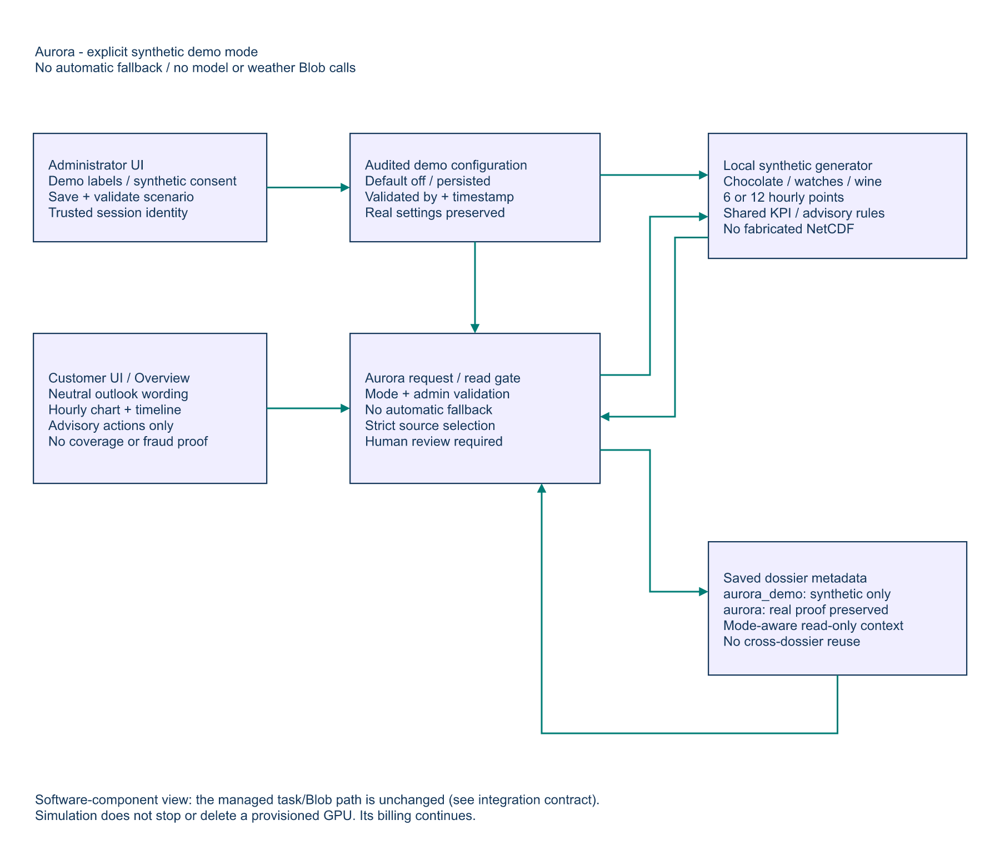
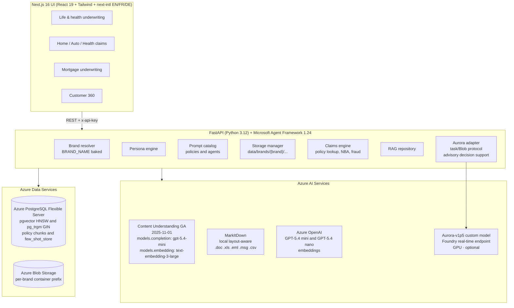
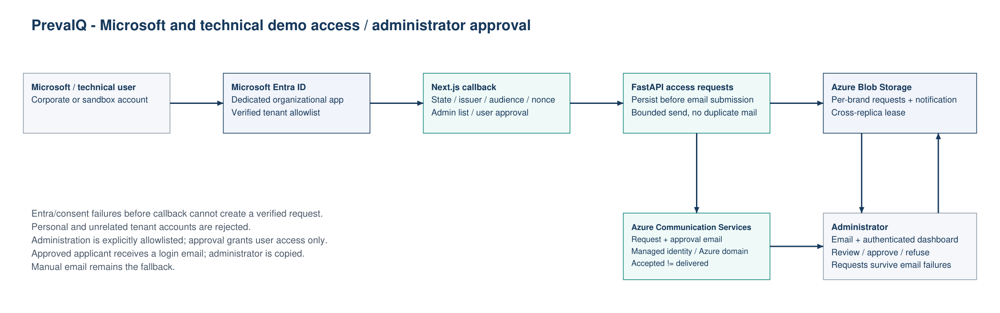
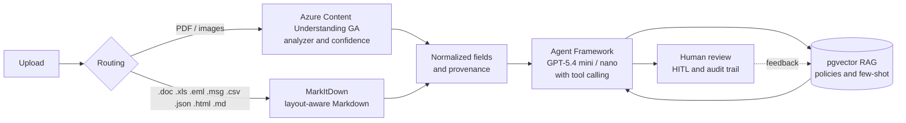
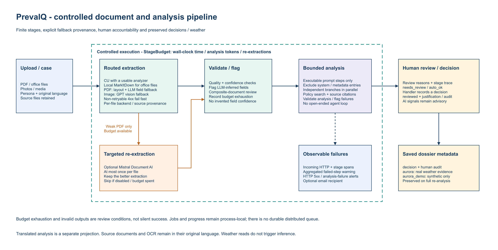
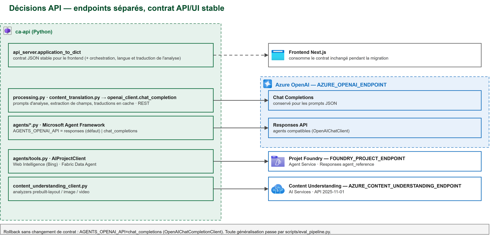

# Architecture



Editable sources and exports are in [docs/architecture/](architecture/) (`.drawio` is the
source of truth, with standalone `.svg` and `.png` exports). MAF agents run inside the
API, not as invented hosted Agent Service instances. The overview distinguishes
public/TLS PostgreSQL, Search and Foundry from private application Blob and Key Vault
access. The API calls Microsoft Web IQ directly through Streamable HTTP MCP; its
credential remains in Key Vault. The location service geocodes once with Nominatim,
while the browser loads map tiles. Fabric is explicitly conditional.

The [Aurora integration contract](architecture/prevaiq-aurora-runtime.png) shows
required control and file paths, not proof of live serving. In the 2026-11-07
snapshot, serving is unavailable and prior historical results remain readable.
The separate model-recovery experiment below has revalidated its own connectivity
and inference; the existing API configuration has not been rebound to it.
No current forecast is claimed by an application health check.



The [editable recovery view](architecture/prevaiq-aurora-recovery.drawio) and
[standalone SVG](architecture/prevaiq-aurora-recovery.svg) record the verified
2026-11-08 experiment in `rg-prevaiq-demo`, Sweden Central. A classic Hub-based
project recovered Aurora-1.5 v2 on one `Standard_NC24ads_A100_v4` instance through
temporary shared capacity. Azure reports automatic deletion on
**2026-11-15 13:30:57 UTC**. The displayed USD 4.78/hour rate is a billed-compute
reference, not a free trial or a spending cap.

The existing VNet-connected bootstrap job exercised the deployed task/Blob adapter
without changing its persistent definition or the application image. It copied
weather-only ERA5 data to the isolated authenticated Storage and produced six
NetCDF outputs and six hourly points in **62.6 seconds**. Initial conditions are
**2026-08-28 06:00 UTC**, so this is historical evidence, not live weather.
The model key stays in the isolated vault with secret-scoped read access;
anonymous Blob and Shared Key access remain disabled. Only the four experimental
resources have the explicitly approved public-network policy exception. Existing
business Storage and Key Vault remain private. No customer documents or claim
records were changed, and expert review remains mandatory.

## Explicit Aurora demo simulation



The [editable source](architecture/prevaiq-aurora-simulation.drawio) and
[self-contained SVG](architecture/prevaiq-aurora-simulation.svg) show application
components, not additional Azure services. Simulation is **off by default** and
never a fallback for a failed inference. An administrator opens **Admin → Aurora**,
authorizes synthetic demo results, chooses chocolate workshop, watch manufacture
or wine cellar, then selects **Save and validate mode** in that same compact card.
The server validates
both 6- and 12-hour scenarios and records the trusted administrator and timestamp.
**Test simulation** checks the local contract; **Test real Azure connection**
still runs the actual dependency checks, without changing modes.

The dossier's **Weather and map** view can then produce hourly charts, timelines,
KPIs and advisory actions without contacting the model or weather Blob Storage.
The application API and dossier/configuration storage must still be available.
Every result carries `source=demo_simulation`, `synthetic=true`, a scenario/version,
and human-review requirements. No ERA5 input or NetCDF artifact is fabricated.
Dates belong to the selected synthetic scenario, not current observed weather.

Synthetic results use `llm_outputs.aurora_demo`; real evidence stays in
`llm_outputs.aurora`. The overview and read-only agent context select the active
mode explicitly and do not generate new weather automatically. Synthetic scenarios
are not evidence of the loss, fraud, coverage or payment. Disable simulation and
save to return to the real configuration and its saved evidence, including genuine
unavailable/expired states. Switching to simulation **does not stop GPU billing**.
Demo/simulation labels, consent, audit and mode-switching instructions are
restricted to **Admin → Aurora**. Customer weather panels, summaries, charts,
timelines and source captions use neutral weather-outlook wording; they do not
display raw synthetic provider/model identifiers or claim successful Azure
inference. The saved API provenance and the agent context retain the explicit
synthetic source. Expert review and non-observation limits remain visible.
The customer demo guide describes the weather-outlook actions, while technical
mode instructions live in the administrator guide. EN/FR/DE are synchronized;
existing demo files, photos, manifests and selection paths are unchanged.

The customer card has one compact primary action in its header (minimum 44 px
target), shared by initial generation and refresh. Three first-level indicators
show maximum gust in km/h (with the original m/s), cumulative rain in mm, and
the reported loss date against the returned hourly window. A day overlap is
explicitly distinguished from an exact timestamp match; missing/invalid dates
and outside-window results never imply causal confirmation. Roof/facade and
water-entry checks are prompts for the handler, not damage findings. The
overview's **Review weather** action opens the existing panel without triggering
inference. Charts, timing, provenance and case actions remain separate detail tabs
inside a disclosure collapsed by default, keeping the initial card short.

Icons preserve their Microsoft service identity and colors; custom/external services
use labeled rectangles without substitute Microsoft logos. Verified asset URLs and
hashes are recorded in [icon provenance](architecture/icon-sources.json).
Regenerate the overview and integration views with `python scripts/render_architecture_diagrams.py` using
draw.io and the temporary `@resvg/resvg-js` rasterizer; pass `--resvg-module` if it
is installed outside the project dependencies. Pass
`docs/architecture/prevaiq-aurora-recovery.drawio` or
`docs/architecture/prevaiq-aurora-simulation.drawio` explicitly to regenerate
the corresponding separate view. Geometry validation is available
with `--check-only`. Diagrams follow the
[architecture authoring skill](../.github/skills/architecture-diagram-author/SKILL.md).



## Data flow

### Microsoft colleague access



[Editable source](architecture/prevaiq-access.drawio) and [standalone SVG](architecture/prevaiq-access.svg).
This separate, icon-free schematic uses labeled rectangles, not substitute product logos; the existing Azure overview remains focused on document processing. Regenerate both exports with `python scripts/render_access_diagram.py`.

The dedicated organizational Entra application authenticates Microsoft colleagues and authorized technical demo accounts. The callback validates the explicit corporate/sandbox tenant allowlist before administrator recognition, requests or sessions. An explicitly allowlisted administrator bypasses user approval; a technical account name alone grants no role. The API saves pending user requests in per-brand Blob Storage with a cross-replica lease, then submits one bounded ACS Email notification through managed identity. Notification failure never removes the request. Administrators review applicant email and approve/refuse in the existing dashboard. A new approval or preauthorization is persisted before sending a confirmation to the applicant with the administrator copied; its submission status is tracked separately. Both emails include simple HTML, a navigation button, the administrator contact and a plain-text fallback. Repeated approvals do not resend, and email failure never revokes access. Provider acceptance is not confirmed inbox delivery; sign-in blocked before callback cannot create a request. See [deployment configuration](deployment.md#microsoft-colleague-access-and-administrator-email).



## Controlled orchestration



The pipeline is extraction -> targeted bounded re-extraction -> validation -> analysis -> human review, with no open-ended agent loop (`app/orchestration.py`).

- **Explicit budgets** per stage (`StageBudget`): wall-clock time through `EXTRACTION_BUDGET_SECONDS` and `ANALYSIS_BUDGET_SECONDS`, analysis tokens through `ANALYSIS_TOKEN_BUDGET`, and re-extractions through `MAX_REEXTRACTIONS`. Exhausted budgets skip remaining files or sections instead of restarting loops.
- **Targeted re-extraction** applies only to documents whose quality score is below `REEXTRACTION_QUALITY_THRESHOLD`, at most once per file, using Mistral Document AI. The best result is kept.
- **Validation** produces review reasons for extraction quality, average confidence below `REVIEW_CONFIDENCE_THRESHOLD`, LLM-extracted fields, composite documents, analysis errors, and exhausted budgets.
- **Human review** uses `orchestration.review.status`: `needs_review`, `auto_ok`, or `reviewed` after `PUT /api/applications/{id}/decision`. The stage trace exposes duration, tokens, re-extractions, and skipped items in `GET /api/applications/{id}` and in the AI pipeline banner.

## API decisions



Ask IQ keeps the existing workflow POST and JSON result contract. Requests with
`stream: true` receive SSE plan, context-stage and per-agent lifecycle events,
followed by a terminal result or explicit error. The Next.js proxy forwards events
without buffering. Independent checks remain parallel and the synthesizer waits
for all branches; no timer invents agent progress. Disconnects cancel the producer.
The UI shows the recommendation first, then the actual execution plan and agent
findings, with unavailable context or branches flagged for human review.

| Usage | API | Endpoint |
|-------|-----|----------|
| JSON analysis prompts and field extraction (`app/openai_client.py`) | Chat Completions, retained | `AZURE_OPENAI_ENDPOINT` |
| Microsoft Agent Framework agents for chat and workflows | Responses through `OpenAIChatClient`, with rollback `AGENTS_OPENAI_API=chat_completions` | `AZURE_OPENAI_ENDPOINT` |
| Foundry agents for Web Intelligence and Fabric Data Agent | Responses `agent_reference` through `AIProjectClient` | `FOUNDRY_PROJECT_ENDPOINT` (`settings.foundry`) |
| Document extraction | Content Understanding GA `2025-11-01` | `AZURE_CONTENT_UNDERSTANDING_ENDPOINT` |
| Aurora weather forecasting for property-claim decision support | Custom task messages plus NetCDF files over Blob Storage; deterministic by default | `AURORA_FOUNDRY_ENDPOINT` and the configured private task container; application I/O uses managed identity and Aurora receives a short-lived delegated SAS |

The API/UI contract stays stable during migration: `application_to_dict` keys are pinned by `tests/test_orchestration.py::test_application_contract_keys_are_stable`. Additions are allowed; removals are not.

Saved Aurora evidence follows the existing dossier-metadata path, not a second model
call. `get_application_summary` embeds a validated temporal/KPI context and the chat,
analysis and case-metrics agents expose the read-only `get_weather_evidence` tool.
The dossier GET returns the same context for the overview and weather tabs. This adds
no service, network path or automatic inference loop: new forecasts remain an explicit
bounded POST, separately gated by generation availability. Stored historical results
cannot predict present weather, distant dates or seasonal climate.

## Evaluation before rollout

`scripts/eval_pipeline.py` runs the reference set in `tests/fixtures/eval/manifest.json` for each variant and compares it to the first variant, which is the baseline.

| Metric | Definition |
|--------|------------|
| `quality` | Share of expected values present in extracted Markdown |
| `completeness` | Share of expected values captured as structured fields |
| `citations` | Share of expected references present in the analysis or workflow |
| `extraction_s`, `analysis_s`, `workflow_s` | Latency by stage |
| `tokens`, `cost` | Analysis tokens and cost, using `tests/fixtures/eval/prices.json` after prices are filled in |

```bash
python scripts/eval_pipeline.py \
  --variant baseline \
  --variant chat_completions:AGENTS_OPENAI_API=chat_completions \
  --workflow express
```

Reports are written to `.tmp/eval/<timestamp>/` as `results.json` and `summary.md`. A variant rolls out only if quality, completeness, and citations are at least baseline, and latency, tokens, and cost stay within the agreed tolerance. The script calls real Azure services and can incur cost.
