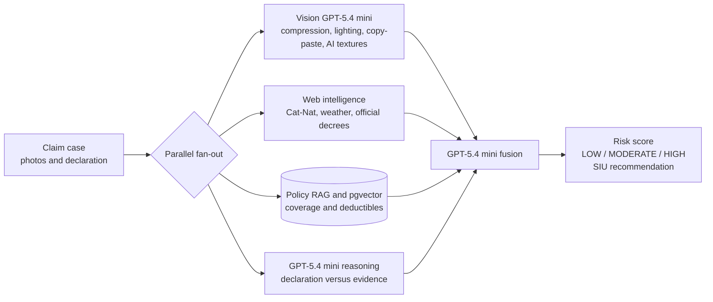
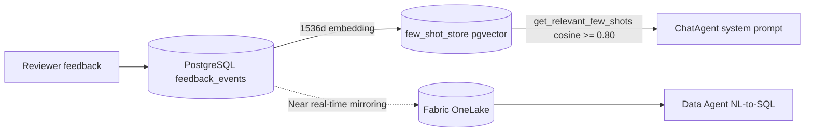

# Features

PrevaIQ supports insurance workbenches, agents, and demo scenarios for claims, underwriting, and Customer 360.

## Business use cases

### Home claims

- **End-to-end workflow**: email/PDF upload -> Content Understanding extraction -> AI analysis -> fraud checks -> Next Best Action -> payment or escalation.
- **Fraud detection**: GPT-5.4 mini vision checks for image authenticity, web intelligence for Cat-Nat verification, and GPT-5.4 mini reasoning for cross-checks.
- **Dynamic Cat-Nat status**: a confirmed Cat-Nat badge can be updated from public sources such as legislation and weather data.
- **Customer empathy**: emotional score based on contact count, delay, claim type, and customer loyalty.
- **AI communication**: contextual email, SMS, or letter generation with empathetic, standard, or formal tone.
- **Straight-through processing**: automatic settlement when conditions pass, confidence is above 95%, and no fraud signal is found.

### Auto claims

- **Multimodal input**: documents, damage photos, and videos with vision analysis.
- **Damage assessment**: visual damage mapping with severity scoring.
- **Auto fraud checks**: photo authenticity, vehicle valuation checks, and staging detection.
- **Assisted decision**: the investigation action is enabled when fraud risk exceeds 70%.

### Health claims

- **Medical workbench**: dedicated panels for lab results, allergies, family history, substances, and occupation.
- **Body-system deep dive**: analysis by medical system, such as cardiovascular or respiratory.
- **Multi-page extraction**: Content Understanding extracts data across pages with different layouts.
- **Policy-driven risk analysis**: scoring with policy references and premium recommendations.
- **Anti-hallucination guardrails**: lab values are shown only when explicitly present in source documents.

### Life & health underwriting

- Processes applications, medical records, lab reports, and risk factors.
- Produces structured medical summaries, requirement lists, and policy-cited risk assessments.

### Mortgage underwriting

- **OSFI B-20 compliance**: automatic GDS/TDS/LTV calculations and stress testing.
- **Property deep dive**: comparable property analysis through Bing grounding.

### Customer 360

- **Unified view**: cross-persona customer profile with realistic demo profiles.
- **Risk correlations**: cross-product pattern detection.

## Agent Framework (Microsoft Agent Framework 1.21)

- **In-process agents** run in the API container on Azure OpenAI through the **Responses** API (`OpenAIChatClient`) with `reasoning effort=low`. Set `AGENTS_OPENAI_API=chat_completions` to roll back to Chat Completions.
- **ChatAgent** provides conversational assistance with tools such as `search_policies`, `get_application_summary`, `get_glossary`, `query_fabric_data`, and `analyze_image_fraud`. UI badges reflect the tools actually called.
- **Web IQ (MCP)** is used when `WEBIQ_API_KEY` is configured through Key Vault. ChatAgent and fraud web-monitoring use Microsoft Web IQ through `webiq_search`; the MCP connection is opened only while the agent searches.
- **AnalysisAgent** performs prompt-based analysis with dynamic section selection.
- **Multi-agent workflows** in `app/agents/workflows.py`: Express `[Extract ∥ Policy] -> Decision`, Complete `[Extract ∥ Analysis ∥ Fraud ∥ Policy] -> Risk`, and Fraud `[FraudDetector ∥ WebIntelligence] -> CrossChecker`. The case context is read once without an LLM; each agent has a timeout and branch-level degradation.
- **HITL learning loop** stores reviewer corrections as few-shot examples in pgvector and injects relevant examples dynamically.
- **Dependencies**: `agent-framework-core>=1.21` and `agent-framework-openai>=1.15`. Do not depend on the `agent-framework` metapackage.

## Fraud detection

The anti-fraud pipeline runs four branches in parallel, then merges results with GPT-5.4 mini into a LOW / MODERATE / HIGH score and an SIU recommendation.

The web-intelligence branch for Cat-Nat, weather, and official decrees is optional. Bing web verification is disabled by default and runs only when `WEB_INTELLIGENCE_ENABLED=true` and `FOUNDRY_PROJECT_ENDPOINT` targets a Foundry agent (`PrevaIQ-WebIntelligence`) with Bing grounding. Without that setup, the anti-fraud pipeline runs on three branches: Vision, RAG, and reasoning. Cat-Nat detection still uses regex recognition and a manual verification task.

## Next Best Action and customer communication

- **Action recommendation**: STP, HITL validation, escalation, or SIU.
- **Confidence score**: percentage plus explicit rationale.
- **AI communication**: contextual email, SMS, or letter generation without Word templates. The agent injects the active brand's insurer contact and never leaks the insured person's contact details.
- **Three tones**: empathetic, standard, and formal.
- **Customer empathy**: emotional score from 0 to 100 based on contacts, delay, loyalty, and claim type.

## Core capabilities

- **Personas**: Life & health underwriting, Health claims, Auto claims, Mortgage underwriting, and Customer 360.
- **Branding**: single active brand, PrevaIQ. `BRAND_NAME` is baked into the Docker image; the multi-brand mechanism and isolated storage path `data/brands/{brand_key}/...` remain in place.
- **Content Understanding GA (2025-11-01)**: custom analyzers with `models.completion` and `models.embedding`, defaulting to `gpt-5.4-mini` and `text-embedding-3-large`, with confidence scoring.
- **MarkItDown ingestion**: local conversion for `.doc`, `.xls`, `.ppt`, `.eml`, `.msg`, `.csv`, `.json`, `.xml`, `.html`, `.md`, and `.txt`, or conversion through Content Understanding.
- **Policy RAG**: pgvector plus hybrid semantic and keyword search over enriched Markdown chunks containing source, analyzer, section, and fields. Policy PDFs are not shipped; put your own files in `assets/pdf/` and run `python scripts/index_pdf_policies.py --force`.
- **Internationalisation**: next-intl FR and EN resources, with locale-aware print reports.
- **Responsive UI**: optimized for narrow mobile screens and ultra-wide displays.
- **Audit trail**: decision traceability with justification.

## Content Understanding + MarkItDown ingestion

The ingestion router chooses between Azure Content Understanding GA for PDFs and images, and MarkItDown for office documents, email, CSV/JSON, HTML, Markdown, and plain text. Both paths produce normalized Markdown enriched with provenance: file, page, analyzer, and model.

- **Content Understanding GA API `2025-11-01`**: `app/content_understanding_client.py` provisions custom analyzers through `ensure_custom_analyzer_exists` with `models.completion = gpt-5.4-mini` and `models.embedding = text-embedding-3-large`, unless overridden by environment variables. `infra/deploy.ps1` aligns resource defaults for `prebuilt-analyzer-completion`, `-completion-mini`, and `-embedding`.
- **MarkItDown**: `app/markitdown_pipeline.py` supports `local`, `cu`, and `auto` modes through `MARKITDOWN_MODE`. It is enabled by default with `MARKITDOWN_ENABLED=true`.

## Souscr'IA connector

The connector is a read-only bridge to the **Souscr'IA** acquisition app. When a case arrives through handoff with `external_reference = <Souscr'IA thread_id>`, PrevaIQ can read the live lead context in real time: security and compliance alerts, fraud-suspicion signals, and the client card.

- **Client**: `app/souscria_mcp_client.py`, JSON-RPC 2.0 over MCP Streamable HTTP (`POST {SOUSCRIA_MCP_URL}/scout/mcp`), Bearer auth with a `service` role, and no new dependency beyond `requests`.
- **Integration**: `GET /api/applications/{id}` adds `souscria_context` when `external_reference` looks like a Souscr'IA thread id (`t-...`). It is non-blocking and degrades gracefully if Souscr'IA is unavailable.
- **Guide**: see [Souscr'IA MCP connector](souscria-mcp-connector.md).

## Internationalisation

- The frontend uses next-intl with English (default) and French message files; the EN/FR switcher stores the choice in a `locale` cookie.
- User-facing strings must go through `useTranslations()`; no hardcoded UI text.
- Translation files are `frontend/messages/fr.json` and `frontend/messages/en.json`.
- Print reports and exports use locale-aware date, number, and currency formatting.

## HITL corrections and learning scenario

### Step 1: ask without corrections

1. Open PrevaIQ and select a home-claim case.
2. Open Ask IQ and turn **manager corrections** off.
3. Ask whether damaged wine bottles stored in a basement are reimbursed.
4. The baseline answer may incorrectly recommend full reimbursement.

### Step 2: correct with feedback

1. Downvote the answer.
2. Enter a correction stating that basement goods are capped by the contract, valuable objects may require an endorsement, and fine wines require expert appraisal.
3. Submit the feedback. It is stored in `workbenchiq.feedback_events` with `agent_type = 'chat_agent'`, `feedback_type = 'correction'`, and `routing_target = 'foundry'` from trigger `trg_feedback_routing`.

### Step 3: verify in Fabric IQ

1. Open the Fabric Portal and your Fabric workspace, then inspect table `feedback_events`.
2. The correction is visible through PostgreSQL to OneLake mirroring.
3. Ask the Data Agent for the latest correction to confirm NL-to-SQL access.

### Step 4: verify learning on a similar case

1. Open another home-claim case with basement-stored goods.
2. Turn **manager corrections** on.
3. Ask a similar reimbursement question.
4. The answer should cite the basement-goods cap, endorsement requirement, and expert appraisal recommendation.

- **Mirroring**: `pg-prevaiq-demo` PostgreSQL to OneLake near real time.
- **Vectorization**: `text-embedding-3-small` with 1536 dimensions through `EmbeddingService`.
- **Injection**: `get_relevant_few_shots(query, persona, agent_type, top_k=3, threshold=0.80)`.
- **UI toggle**: `ChatDrawer.tsx` sends `useCorrections` to the backend.

## Available workbenches

| Persona | Status | Description |
|---------|--------|-------------|
| **Life & Health Underwriting** | Active | Life insurance underwriting for applications, medical records, lab results, and risk assessment |
| **Health Claims** | Active | Health insurance claims for eligibility verification, medical necessity review, and benefits adjudication |
| **Auto Claims** | Active | Multimodal vehicle claims with damage assessment, liability, and fraud detection over images, videos, and documents |
| **Mortgage Underwriting** | Active | Canadian residential mortgage assessment with OSFI B-20 compliance, GDS/TDS/LTV calculations, and stress testing |
| **Customer 360** | Active | Cross-persona customer journey timeline, risk correlations, and persona summary cards |

