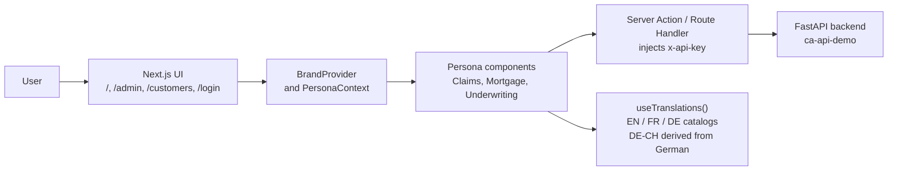

# WorkbenchIQ Next.js frontend

This brand-agnostic Next.js 16 UI uses PrevaIQ as the default brand for the insurance agentic workbench. It covers five workbenches: Life & health underwriting, Property claims, Auto claims, Health claims and Mortgage underwriting, plus Customer 360. English, French, German and Swiss German UI locales are available.

## Stack

- **Next.js 16** with App Router, `'use client'`, React 19.2, and TypeScript.
- **Tailwind CSS** with `primary-*` / `brand-*` palettes mapped to PrevaIQ colors `#17395C`, `#2EC4B6`, and `#0F2E4D`.
- **next-intl** for English, French, German and Swiss German translations and locale-aware print reports.
- **lucide-react** for icons and **clsx** for conditional classes.
- Server-side API proxy that injects `x-api-key`; the key is never exposed to the browser.

## Architecture



## Structure

```
frontend/
├── src/
│   ├── app/                    # Pages, App Router
│   │   ├── layout.tsx          # <html lang="fr">, BrandProvider, PersonaProvider
│   │   ├── page.tsx            # Landing page
│   │   ├── admin/              # Admin console for documents, prompts, analyzers
│   │   ├── customers/          # Customer 360
│   │   └── login/              # Authentication
│   ├── components/             # 40+ components
│   │   ├── TopNav.tsx · Sidebar.tsx · LandingPage.tsx
│   │   ├── claims/             # AutomotiveClaimsOverview, LifeHealthClaimsOverview, ...
│   │   ├── mortgage/           # MortgageOverview, MortgagePolicyEditor, ...
│   │   └── ProcessingBanner.tsx · DemoGuide.tsx · GlossaryManager.tsx
│   ├── lib/                    # api.ts, personas.ts, PersonaContext.tsx, auth.ts, types.ts
│   └── i18n/                   # next-intl configuration
├── messages/                   # fr.json reference and en.json mirror
├── public/
│   ├── prevaiq-logo.png · prevaiq-logo-dark.png  # Exact FDR wordmarks
│   ├── prevaiq-icon.png · prevaiq-icon-dark.png  # Exact FDR icons
│   ├── favicon.svg            # Exact FDR browser favicon
│   └── prevaiq-logo.svg · favicon-prevaiq.svg    # Official compatibility aliases
├── package.json · tailwind.config.js · tsconfig.json · next.config.js
```

## Conversation history

Ask IQ history is loaded through the Next.js proxy from
`GET /api/applications/{id}/conversations` and `GET /api/conversations?limit=50`.
The backend stores `.conversation-{id}.json` files with each application; the
demo PDF/photo manifests do not seed chat history. A case with no saved chats
returns **200** with `{"conversations":[]}`. A **404** from the list endpoint is
not an empty history: check the backend URL and whether a local fixture exposes
the real history routes before changing data.

The history panel validates the list response, retains HTTP diagnostics and
offers **Retry** for failed loads, refreshes or deletes. Failed deletion does not
remove a conversation from the UI. Switching case/tab cancels the previous
request and prevents late results from appearing in another case. Handled
failures are logged as warnings and shown in the panel, not as generic Next.js
console-error overlays. The claims demo guide explains empty history and retry;
sample files, manifests and upload selections remain unchanged.

Focused checks: `node --test tests/chatHistory.test.js` from this folder, and
`uv run --no-sync python -m pytest tests/test_conversation_storage.py` from the
repository root. UI fixtures must expose the actual conversation routes, not
only the weather endpoints.

## Case label localization

Known extracted claim-type and urgency enum labels are localized in both the
overview identity and the main chronology through the same safe alias helper.
The pure chronology builders live under `src/components/chronology/`; source
fields, free-form descriptions, names, references and original documents are
not rewritten. French `sinistre élémentaire` and high/critical urgency values
from French, English and German are recognized.

The property AI summary labels field names and coded values (for example
`statut` / `partiellement_acceptable`) with the `analysis_labels` returned with a
translated analysis: static labels first, then those, then the humanized name.
Stored keys and codes never change. Summary tabs are routed from French, English
and German headings, and the model's own output-language tag (`langue: fr`) is
not displayed because it is wrong once the analysis is translated.

The extracted-text panel also localizes recognized generated photo-analysis
headings in the translated view, including legacy `Analyse des Photos` wrappers.
It only changes the first generated Markdown heading when it names the exact
image file being read. This prevents a French wrapper from remaining in DE/DE-CH
when language detection correctly identifies the body as German and skips
translation. Filenames, the body, persisted content and Original mode remain
unchanged; PDF headings, quotations, code and mismatching filenames are not
rewritten. Original mode is explicitly indicated even when no machine translation
is required, with a control to return to the translated view. The literal-JSX audit is a static-label check, not a guarantee that
arbitrary source documents or generated prose are in the selected UI language.

Administration and Client 360 use a compact named currency menu with current
selection, keyboard navigation, Escape/outside dismissal and the reference-only
hint. The login page keeps its native select. The existing cookie/provider still
controls persistence; an explicit case currency always wins, with no FX conversion.

Ask IQ suggestion chips use a compact grid instead of a nested scrolling strip.
Displayed Markdown responses support colored headings, bold/italic emphasis and
underlined policy references. Only unambiguous IDs provided by citation metadata
become policy-viewer buttons; unknown references, code and existing links are not
rewritten. Raw HTML is not enabled. Policy content and quoted source wording stay
unchanged. Policy details use the same configured persona-to-catalog resolver as
the policy list, including habitation claims, rather than a separate mapping that
could incorrectly fall back to underwriting.
The viewer validates the requested ID and detail structure, cancels stale requests,
and provides localized HTTP/connection errors with a Retry action. It never displays
an incomplete response or a different policy as a successful lookup.
Only criteria with a defined risk level show a level badge and a risk color; the
claims catalogs define none, so their criteria use a neutral card without a badge.
Live, streamed and restored conversations also expose `policy_citations` resolved
from exact policy/unique criteria IDs in the selected persona catalog. These are
catalog references, not claimed vector-retrieval results. Unknown IDs and ambiguous
criteria are not linked. Reading older conversations enriches only the response
metadata; stored messages and source documents are not rewritten.

A successful Aurora refresh clears a previous saved-result load error but does
not clear an unresolved service-status error. The admin scenario remains an
explicit global choice for new requests; changing it does not rewrite saved
evidence or automatically select a different scenario for another case. Older
saved results without provenance remain readable; missing source details are
shown as unavailable instead of causing a rendering exception.

The login language switcher and account menu offer EN, FR, DE and **DE-CH**
(`de-CH`, Deutsch (Schweiz)). The locale cookie, HTML language and `next-intl`
provider retain the regional locale for Swiss number and date formatting.
DE-CH inherits the current German catalog, replacing `ß` / `ẞ` with `ss` / `SS`
in message values, including nested demo steps; DE remains unchanged. This avoids
duplicating a catalog that would drift as the German UI evolves.
Original documents, case data and policy references are never rewritten.
German source documents are not treated as foreign solely because the UI uses
DE-CH. Generated-content requests retain `de-CH` through the backend: Ask IQ,
workflows, analyses, communications and translated projections ask for Swiss
Standard German (Schweizer Hochdeutsch), not dialect, with `ss` instead of `ß`.
DE and DE-CH use separate generated-content caches. Glossary translations also
retain the variant; a failed translation is explicitly shown in its original language.
Quoted source evidence, names, references, currencies and the case jurisdiction
remain unchanged. Web IQ still searches in the language and country of the sources,
independently of the requested answer variant.
The Swiss chocolate demo guide explicitly points to the DE-CH option; demo assets,
file selections and upload folders are unchanged.
Fallback case titles also resolve DE-CH to German, while stored titles, names and
document filenames remain verbatim. Locale regression tests exercise the complete
Swiss message catalog, ICU arguments, cockpit labels, amounts and expertise
thresholds, API language forwarding and the unchanged decision payloads.

Dashboard queues, list/grid descriptions and case navigation translate known claim
categories using `claimSubjects` in the English, French and German message catalogs.
Compound categories (for example hail / storm) are translated before title shortening,
including the full hover title. Search matches both localized labels and original case
data. Customer names, policy references, unknown free-form descriptions and source
documents are preserved; switching locale does not rewrite stored case data.

Persona menu labels, the selected persona and dashboard headings use `persona.labels`
for the active locale; canonical persona IDs and registry names remain unchanged.
The glossary heading also uses this translated label, never the API's source-language
glossary name (for example, **Property Claims Glossary** in English).
Demo-guide scenario tabs and instructions use the same localized persona wording.
File selections and demo folders are not affected by these display-only translations.

## Application appearance

The account submenu offers **Appearance -> Light template / Dark template**.
Administration and Client 360 also expose an Appearance control in their headers.
The `app-theme` cookie persists the selection for one year across all routes and
language switches. The server renders the saved theme before first paint; switching
appearance updates it in place without reloading or changing the open case/page.
The login screen retains its independent `login-theme` setting.

The shared Tailwind theme adapts cards, reading text, buttons, selected/hover/focus
states, status colors, forms, tables, gradients and overlays across personas.
Inline brand labels use a separate reading-ink token rather than changing action
fills. Dark reading/status palette pairs meet WCAG AA text contrast (4.5:1);
keyboard focus has an explicit visible outline in both themes.
Official logos use their light/dark surface variants, never CSS filters.
Demo partner-logo islands and original PDF/photo content retain their actual
colors; only the surrounding viewer UI changes. Print output remains light.
The demo guide uses the selected theme without changing file selections or folders.

## Claims workspace

Auto and property claims share six primary views, in order: Overview, Evidence,
Analysis & facts, Customer, Weather & map, and Timeline. Technical source pages,
extracted data and the AI pipeline are available under More. View URLs survive
reloads and language switches. Analysis uses accessible tabs with one active section;
the AI synthesis also shows one topic at a time in a bounded reader. The claim chronology
has one main view.

Overview shortcuts start a new fraud analysis directly or open an existing report.
Web IQ sources are separately visible, but execution remains explicitly coupled
to fraud analysis. Switching views does not unmount the analysis runner.
Property Overview KPI cards use the existing recommendation/sentiment palette:
rose for priority review, amber for required checks, green for low-risk/calm
indicators, blue for context, violet for running analysis and grey for unknowns.
Backgrounds, borders and icons retain their tone on hover and adapt to both themes.
Coverage and Web IQ context are not colored green merely because an event was
confirmed or sources were found. Labels and evidence remain the source of meaning;
no risk threshold, decision, navigation action or demo file selection changes.
The property demo guide explains these colors in EN/FR/DE/DE-CH.
Decision choices use persistent green/amber/grey/red styling and require human
confirmation. Customer drafts are editable, never automatically sent, and a
standard-template fallback is explicitly labeled if AI generation fails.
The composer translates tone labels and the entire generated draft (including
SMS and adviser signatures) into the selected locale while preserving names,
filenames, source quotations and contact details. Channel and tone controls use
consistent readable sizing; SMS drafts have a compact editor. Changing locale
or case cancels generation and clears the previous draft.

Ask IQ workflows show the final recommendation first, followed by an ordered
execution plan and expandable agent findings with localized role labels and icons.
The existing workflow POST accepts `stream: true`: it emits SSE `plan`, context
`stage`, agent `step`, and terminal `done`/`error` events. Independent agents run
in parallel; synthesis waits for their terminal states. The Next.js proxy forwards
the stream without buffering. Statuses reflect actual execution, not elapsed-time
estimates. Missing case context or a failed branch is shown as unavailable and flags human review; a broken
stream never becomes a completed result. Changing case/conversation or unmounting
cancels the request. The client budget covers context reading and both bounded
agent stages. Existing JSON clients remain supported.

Weather & map always exposes Aurora availability, including a disabled state;
charts require actual saved forecast data. The UI never fabricates weather or
enables the service by navigating to the view. EN/FR/DE/DE-CH demo-guide navigation is
synchronized; demo assets and upload sets are unchanged.

The weather workspace separates Aurora, loss location and saved Web IQ findings.
Aurora shows one chart/timing/provenance/actions view at a time, with manual timeline
playback. The chart is capped at 768 px wide and the map viewport at 288 px tall;
its inner tile canvas retains the 2:1 geometry. Switching tabs never submits inference
or starts the coupled fraud/Web IQ run.

Auto/property Overview and the property AI summary include a compact saved-evidence
card. Its exact valid-time window is distinct from the request date. Historical
simulations are not current observations or distant forecasts. Ask IQ's **Case metrics**
mode reads dossier figures; portfolio queries still require a connected Fabric source.

## Shared brand assets

PrevaIQ uses the **exact official FDR files**, not a redrawn SVG or a CSS-recolored logo.
The canonical PNGs are `../assets/logos/prevaiq_icon.png`, `prevaiq_icon_dark.png`,
`prevaiq_logo.png` and `prevaiq_logo_dark.png`; their public copies use hyphenated names.
`BrandMark` renders the PNG wordmark with intrinsic dimensions and preserved aspect ratio,
without image conversion. Use `surface="dark"` on dark surfaces (the sidebar); white
cards, including the login splash card and guided-demo footer, use the light variant.
Application appearance selects the matching official logo for themed surfaces;
explicit light/dark surfaces such as login panels and demo partner cards stay scoped.

Root metadata uses `/favicon.svg` for browser/shortcut icons and `/prevaiq-icon.png`
for the PNG Apple touch icon. `/favicon-prevaiq.svg` remains a byte-identical favicon
alias. The legacy `public/prevaiq-logo.svg` and `assets/logos/prevaiq-logo.svg` are exact
copies of the official FDR wordmark SVG, retained for existing links, not used by the UI.
`assets/logo-prevaiq.png` and `assets/logos/logo-prevaiq.png` retain their paths for
existing document-generation consumers and contain the official light PNG.
Official SVG files are marked binary in `.gitattributes` to preserve their original
bytes (including line endings) on both Windows and Unix checkouts.

`npm run test:branding` checks pinned SHA-256 values for canonical files and aliases,
rendered light/dark and compact logos, root metadata, and UI integration (header,
login, access, administration, Customer 360, sidebar and guided demo). It needs no
FDR checkout or extra dependency. After an approved brand update, copy the official
files without conversion and deliberately update these pinned hashes together.
No demo scenario text, file selection or PDF dataset was changed by this UI update.

## Prerequisites

- Node.js 20+.
- FastAPI backend; see the [root README](../README.md).

## Quick start

```bash
cd frontend
npm install
npm run dev          # http://localhost:3000
```

## Environment

Create `.env.local`:

```env
# FastAPI backend URL for the server-side proxy.
BACKEND_API_URL=http://localhost:8000

# Shared API key with the backend, injected server-side and never exposed to the browser.
API_KEY=your-secret-api-key-at-least-32-characters-long

# Active brand, PrevaIQ by default and currently the only defined brand.
NEXT_PUBLIC_BRAND_NAME=PrevaIQ
```

## Brand

The frontend is brand-agnostic. No brand name or color is hardcoded in components. Branding comes from the `brand` object in `src/lib/brand.ts`: name, company, logo, favicon, palette, demo asset folder, customer ID prefix, and insurer phone. The brand is resolved at build time through `NEXT_PUBLIC_BRAND_NAME` and `--build-arg BRAND_NAME=PrevaIQ` in the Dockerfile.

- Labels use `t('key', { brand: brand.name })` with `{brand}` placeholders in `messages/*.json`.
- Colors use `brand.primary`, `brand.secondary`, `brand.accent`, or Tailwind `primary-*` / `brand-*` classes.
- To add a brand, add an entry in `brands` in `src/lib/brand.ts`, add assets under `public/`, and align `tailwind.config.js`.

## Internationalisation

All user-facing strings must use `useTranslations()`; do not hardcode UI text.

- Add keys to `messages/fr.json`, then mirror them in `messages/en.json`.
- Use interpolation such as `t('claim.status', { name })`.
- Use `src/lib/currency.ts` for locale-aware currency formatting. `useApplicationCurrency`
  preserves an explicit case currency; otherwise it uses the selected reference currency
  (USD, EUR or CHF; EUR by default). This is not foreign-exchange conversion.
- The reference currency is stored in the `reference-currency` cookie and restored
  by `CurrencyProvider` before rendering, independently of language and theme.
- EN and FR are direct choices; the DE submenu offers German (DE) and Swiss German
  (DE-CH) in the account menu and compact language controls.
- A single sun/moon button switches to the other theme.

## Component design

Follow the repository's SOLID, DRY, and YAGNI rules.

- **SRP**: one component has one responsibility. A tab panel belongs in its own file.
- **No god components**: refactor components above roughly 400 lines, such as `admin/page.tsx`, `LandingPage.tsx`, or `LifeHealthClaimsOverview.tsx`.
- **Co-location**: keep related files together, such as `components/admin/DocumentsTab.tsx` and `components/admin/useAdminState.ts`.
- **Custom hooks**: use hooks for reusable logic, such as `useApplications` and `useToast`.

### Form selectors

Single-value native selectors share their presentation in `src/app/globals.css`.
Browsers supporting `appearance: base-select` render a rounded, scrollable picker
with 40px option targets, a selected-option checkmark and theme-aware focus/hover
states. Other browsers keep the system picker; native keyboard navigation,
form validation, values and change handlers are preserved. Multi-select and
explicitly sized listboxes are left unchanged. Forced-colors mode uses the system picker.

The login currency control keeps its short code when closed and displays localized
currency names in the enhanced picker. Its palette follows the independent login
theme on `/login`. The existing application currency menu is preserved.
No demo-guide labels, scenario references, assets or file selections change;
demo-settings selectors inherit the shared styles.

## Login appearance

`/login` follows Nemo's centered hero/card layout, with the EN/FR/DE locale
controls, DE-CH nested under DE, reference currency and one theme icon at the top right. Its CSS
tokens and `login-theme` cookie (path `/login`) are isolated from the rest of the
app; the server restores the theme before rendering. Official logos still use
`BrandMark`, selected for the actual surface. Authentication and access links are
unchanged. The Swiss demo guide explains the DE submenu and preservation of CHF
case amounts; demo-file references are unchanged.

Run the focused presentation, branding and authentication checks together:
`node --test tests/login.test.js tests/branding.test.js tests/auth.test.js`.
The login-only suite is also available as `npm run test:login`.
Preference and formatting regressions:
`node --test tests/login.test.js tests/currency.test.js tests/theme.test.js tests/i18n.test.js`.

## Build and deploy

```bash
npm run lint         # ESLint + Next.js
npm run build        # Production build and type check
npm start            # Serve local production build
```

Deployment is handled by `infra/deploy.ps1`, which builds in ACR, pushes images, and updates Azure Container Apps. See the [root README](../README.md).

## API surface used

- `GET /api/applications` and `POST /api/applications` multipart upload.
- `GET /api/applications/{id}`.
- `POST /api/applications/{id}/extract` and `POST /api/applications/{id}/analyze`.
- `POST /api/chat` for ChatAgent tool calling.
- `GET /api/policies` and `PUT /api/prompts/{section}/{subsection}`.
- `GET /api/customers/{id}` for Customer 360.

The full list is in the root `README.md` API Reference section.
