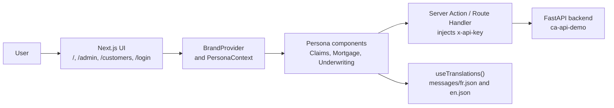

# WorkbenchIQ Next.js frontend

This brand-agnostic Next.js 14 UI uses PrevaIQ as the default brand for the insurance agentic workbench. It covers five personas: Life & health underwriting, Home claims, Auto claims, Health claims, Mortgage underwriting, and Customer 360. French and English UI resources are available.

## Stack

- **Next.js 14** with App Router, `'use client'`, React 18, and TypeScript.
- **Tailwind CSS** with `primary-*` / `brand-*` palettes mapped to PrevaIQ colors `#17395C`, `#2EC4B6`, and `#0F2E4D`.
- **next-intl** for French and English translations and locale-aware print reports.
- **lucide-react** for icons and **clsx** for conditional classes.
- Server-side API proxy that injects `x-api-key`; the key is never exposed to the browser.

## Architecture



## Structure

```
frontend/
├── src/
│   ├── app/                    # Pages, App Router
│   │   ├── layout.tsx          # <html lang="fr">, BrandProvider, PersonaProvider
│   │   ├── page.tsx            # Landing page
│   │   ├── admin/              # Admin console for documents, prompts, analyzers
│   │   ├── customers/          # Customer 360
│   │   └── login/              # Authentication
│   ├── components/             # 40+ components
│   │   ├── TopNav.tsx · Sidebar.tsx · LandingPage.tsx
│   │   ├── claims/             # AutomotiveClaimsOverview, LifeHealthClaimsOverview, ...
│   │   ├── mortgage/           # MortgageOverview, MortgagePolicyEditor, ...
│   │   └── ProcessingBanner.tsx · DemoGuide.tsx · GlossaryManager.tsx
│   ├── lib/                    # api.ts, personas.ts, PersonaContext.tsx, auth.ts, types.ts
│   └── i18n/                   # next-intl configuration
├── messages/                   # fr.json reference and en.json mirror
├── public/
│   ├── prevaiq-logo.svg        # Brand logo referenced by brand.logo
│   └── favicon-prevaiq.svg     # Brand favicon referenced by brand.favicon
├── package.json · tailwind.config.js · tsconfig.json · next.config.js
```

## Prerequisites

- Node.js 20+.
- FastAPI backend; see the [root README](../README.md).

## Quick start

```bash
cd frontend
npm install
npm run dev          # http://localhost:3000
```

## Environment

Create `.env.local`:

```env
# FastAPI backend URL for the server-side proxy.
BACKEND_API_URL=http://localhost:8000

# Shared API key with the backend, injected server-side and never exposed to the browser.
API_KEY=your-secret-api-key-at-least-32-characters-long

# Active brand, PrevaIQ by default and currently the only defined brand.
NEXT_PUBLIC_BRAND_NAME=PrevaIQ
```

## Brand

The frontend is brand-agnostic. No brand name or color is hardcoded in components. Branding comes from the `brand` object in `src/lib/brand.ts`: name, company, logo, favicon, palette, demo asset folder, customer ID prefix, and insurer phone. The brand is resolved at build time through `NEXT_PUBLIC_BRAND_NAME` and `--build-arg BRAND_NAME=PrevaIQ` in the Dockerfile.

- Labels use `t('key', { brand: brand.name })` with `{brand}` placeholders in `messages/*.json`.
- Colors use `brand.primary`, `brand.secondary`, `brand.accent`, or Tailwind `primary-*` / `brand-*` classes.
- To add a brand, add an entry in `brands` in `src/lib/brand.ts`, add assets under `public/`, and align `tailwind.config.js`.

## Internationalisation

All user-facing strings must use `useTranslations()`; do not hardcode UI text.

- Add keys to `messages/fr.json`, then mirror them in `messages/en.json`.
- Use interpolation such as `t('claim.status', { name })`.
- Use locale-aware helpers in `src/lib/format.ts` for dates, numbers, and currency.

## Component design

Follow the repository's SOLID, DRY, and YAGNI rules.

- **SRP**: one component has one responsibility. A tab panel belongs in its own file.
- **No god components**: refactor components above roughly 400 lines, such as `admin/page.tsx`, `LandingPage.tsx`, or `LifeHealthClaimsOverview.tsx`.
- **Co-location**: keep related files together, such as `components/admin/DocumentsTab.tsx` and `components/admin/useAdminState.ts`.
- **Custom hooks**: use hooks for reusable logic, such as `useApplications` and `useToast`.

## Build and deploy

```bash
npm run lint         # ESLint + Next.js
npm run build        # Production build and type check
npm start            # Serve local production build
```

Deployment is handled by `infra/deploy.ps1`, which builds in ACR, pushes images, and updates Azure Container Apps. See the [root README](../README.md).

## API surface used

- `GET /api/applications` and `POST /api/applications` multipart upload.
- `GET /api/applications/{id}`.
- `POST /api/applications/{id}/extract` and `POST /api/applications/{id}/analyze`.
- `POST /api/chat` for ChatAgent tool calling.
- `GET /api/policies` and `PUT /api/prompts/{section}/{subsection}`.
- `GET /api/customers/{id}` for Customer 360.

The full list is in the root `README.md` API Reference section.

