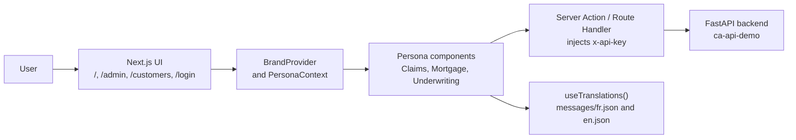

# WorkbenchIQ Next.js frontend

This brand-agnostic Next.js 14 UI uses PrevaIQ as the default brand for the insurance agentic workbench. It covers five personas: Life & health underwriting, Home claims, Auto claims, Health claims, Mortgage underwriting, and Customer 360. French and English UI resources are available.

## Stack

- **Next.js 14** with App Router, `'use client'`, React 18, and TypeScript.
- **Tailwind CSS** with `primary-*` / `brand-*` palettes mapped to PrevaIQ colors `#17395C`, `#2EC4B6`, and `#0F2E4D`.
- **next-intl** for French and English translations and locale-aware print reports.
- **lucide-react** for icons and **clsx** for conditional classes.
- Server-side API proxy that injects `x-api-key`; the key is never exposed to the browser.

## Architecture



## Structure

```
frontend/
├── src/
│   ├── app/                    # Pages, App Router
│   │   ├── layout.tsx          # <html lang="fr">, BrandProvider, PersonaProvider
│   │   ├── page.tsx            # Landing page
│   │   ├── admin/              # Admin console for documents, prompts, analyzers
│   │   ├── customers/          # Customer 360
│   │   └── login/              # Authentication
│   ├── components/             # 40+ components
│   │   ├── TopNav.tsx · Sidebar.tsx · LandingPage.tsx
│   │   ├── claims/             # AutomotiveClaimsOverview, LifeHealthClaimsOverview, ...
│   │   ├── mortgage/           # MortgageOverview, MortgagePolicyEditor, ...
│   │   └── ProcessingBanner.tsx · DemoGuide.tsx · GlossaryManager.tsx
│   ├── lib/                    # api.ts, personas.ts, PersonaContext.tsx, auth.ts, types.ts
│   └── i18n/                   # next-intl configuration
├── messages/                   # fr.json reference and en.json mirror
├── public/
│   ├── prevaiq-logo.png · prevaiq-logo-dark.png  # Exact FDR wordmarks
│   ├── prevaiq-icon.png · prevaiq-icon-dark.png  # Exact FDR icons
│   ├── favicon.svg            # Exact FDR browser favicon
│   └── prevaiq-logo.svg · favicon-prevaiq.svg    # Official compatibility aliases
├── package.json · tailwind.config.js · tsconfig.json · next.config.js
```

## Case label localization

Dashboard queues, list/grid descriptions and case navigation translate known claim
categories using `claimSubjects` in the English, French and German message catalogs.
Compound categories (for example hail / storm) are translated before title shortening,
including the full hover title. Search matches both localized labels and original case
data. Customer names, policy references, unknown free-form descriptions and source
documents are preserved; switching locale does not rewrite stored case data.

Persona menu labels, the selected persona and dashboard headings use `persona.labels`
for the active locale; canonical persona IDs and registry names remain unchanged.
The glossary heading also uses this translated label, never the API's source-language
glossary name (for example, **Property Claims Glossary** in English).
Demo-guide scenario tabs and instructions use the same localized persona wording.
File selections and demo folders are not affected by these display-only translations.

## Shared brand assets

PrevaIQ uses the **exact official FDR files**, not a redrawn SVG or a CSS-recolored logo.
The canonical PNGs are `../assets/logos/prevaiq_icon.png`, `prevaiq_icon_dark.png`,
`prevaiq_logo.png` and `prevaiq_logo_dark.png`; their public copies use hyphenated names.
`BrandMark` renders the PNG wordmark with intrinsic dimensions and preserved aspect ratio,
without image conversion. Use `surface="dark"` on dark surfaces (the sidebar); white
cards, including the login splash card and guided-demo footer, use the light variant.
This does not introduce an application-wide theme switch or change the app palette.

Root metadata uses `/favicon.svg` for browser/shortcut icons and `/prevaiq-icon.png`
for the PNG Apple touch icon. `/favicon-prevaiq.svg` remains a byte-identical favicon
alias. The legacy `public/prevaiq-logo.svg` and `assets/logos/prevaiq-logo.svg` are exact
copies of the official FDR wordmark SVG, retained for existing links, not used by the UI.
`assets/logo-prevaiq.png` and `assets/logos/logo-prevaiq.png` retain their paths for
existing document-generation consumers and contain the official light PNG.
Official SVG files are marked binary in `.gitattributes` to preserve their original
bytes (including line endings) on both Windows and Unix checkouts.

`npm run test:branding` checks pinned SHA-256 values for canonical files and aliases,
rendered light/dark and compact logos, root metadata, and UI integration (header,
login, access, administration, Customer 360, sidebar and guided demo). It needs no
FDR checkout or extra dependency. After an approved brand update, copy the official
files without conversion and deliberately update these pinned hashes together.
No demo scenario text, file selection or PDF dataset was changed by this UI update.

## Prerequisites

- Node.js 20+.
- FastAPI backend; see the [root README](../README.md).

## Quick start

```bash
cd frontend
npm install
npm run dev          # http://localhost:3000
```

## Environment

Create `.env.local`:

```env
# FastAPI backend URL for the server-side proxy.
BACKEND_API_URL=http://localhost:8000

# Shared API key with the backend, injected server-side and never exposed to the browser.
API_KEY=your-secret-api-key-at-least-32-characters-long

# Active brand, PrevaIQ by default and currently the only defined brand.
NEXT_PUBLIC_BRAND_NAME=PrevaIQ
```

## Brand

The frontend is brand-agnostic. No brand name or color is hardcoded in components. Branding comes from the `brand` object in `src/lib/brand.ts`: name, company, logo, favicon, palette, demo asset folder, customer ID prefix, and insurer phone. The brand is resolved at build time through `NEXT_PUBLIC_BRAND_NAME` and `--build-arg BRAND_NAME=PrevaIQ` in the Dockerfile.

- Labels use `t('key', { brand: brand.name })` with `{brand}` placeholders in `messages/*.json`.
- Colors use `brand.primary`, `brand.secondary`, `brand.accent`, or Tailwind `primary-*` / `brand-*` classes.
- To add a brand, add an entry in `brands` in `src/lib/brand.ts`, add assets under `public/`, and align `tailwind.config.js`.

## Internationalisation

All user-facing strings must use `useTranslations()`; do not hardcode UI text.

- Add keys to `messages/fr.json`, then mirror them in `messages/en.json`.
- Use interpolation such as `t('claim.status', { name })`.
- Use locale-aware helpers in `src/lib/format.ts` for dates, numbers, and currency.

## Component design

Follow the repository's SOLID, DRY, and YAGNI rules.

- **SRP**: one component has one responsibility. A tab panel belongs in its own file.
- **No god components**: refactor components above roughly 400 lines, such as `admin/page.tsx`, `LandingPage.tsx`, or `LifeHealthClaimsOverview.tsx`.
- **Co-location**: keep related files together, such as `components/admin/DocumentsTab.tsx` and `components/admin/useAdminState.ts`.
- **Custom hooks**: use hooks for reusable logic, such as `useApplications` and `useToast`.

## Login appearance

`/login` follows Nemo's centered hero/card layout, with the existing EN/FR locale
cookie and segmented language/theme controls together at the top right. Its CSS
tokens and `login-theme` cookie (path `/login`) are isolated from the rest of the
app; the server restores the theme before rendering. Official logos still use
`BrandMark`, selected for the actual surface. Authentication and access links are
unchanged. No demo-guide content or demo-file references are affected.

Run the focused presentation, branding and authentication checks together:
`node --test tests/login.test.js tests/branding.test.js tests/auth.test.js`.
The login-only suite is also available as `npm run test:login`.

## Build and deploy

```bash
npm run lint         # ESLint + Next.js
npm run build        # Production build and type check
npm start            # Serve local production build
```

Deployment is handled by `infra/deploy.ps1`, which builds in ACR, pushes images, and updates Azure Container Apps. See the [root README](../README.md).

## API surface used

- `GET /api/applications` and `POST /api/applications` multipart upload.
- `GET /api/applications/{id}`.
- `POST /api/applications/{id}/extract` and `POST /api/applications/{id}/analyze`.
- `POST /api/chat` for ChatAgent tool calling.
- `GET /api/policies` and `PUT /api/prompts/{section}/{subsection}`.
- `GET /api/customers/{id}` for Customer 360.

The full list is in the root `README.md` API Reference section.
